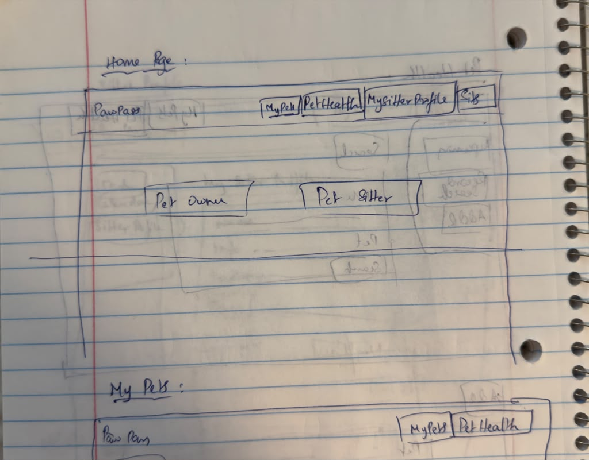
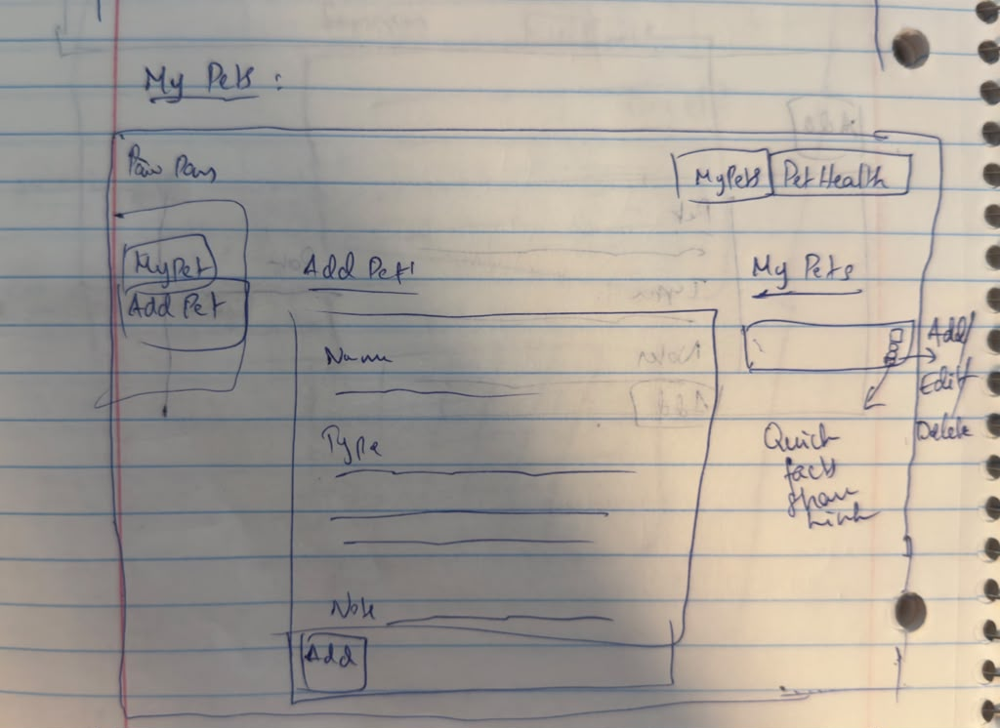
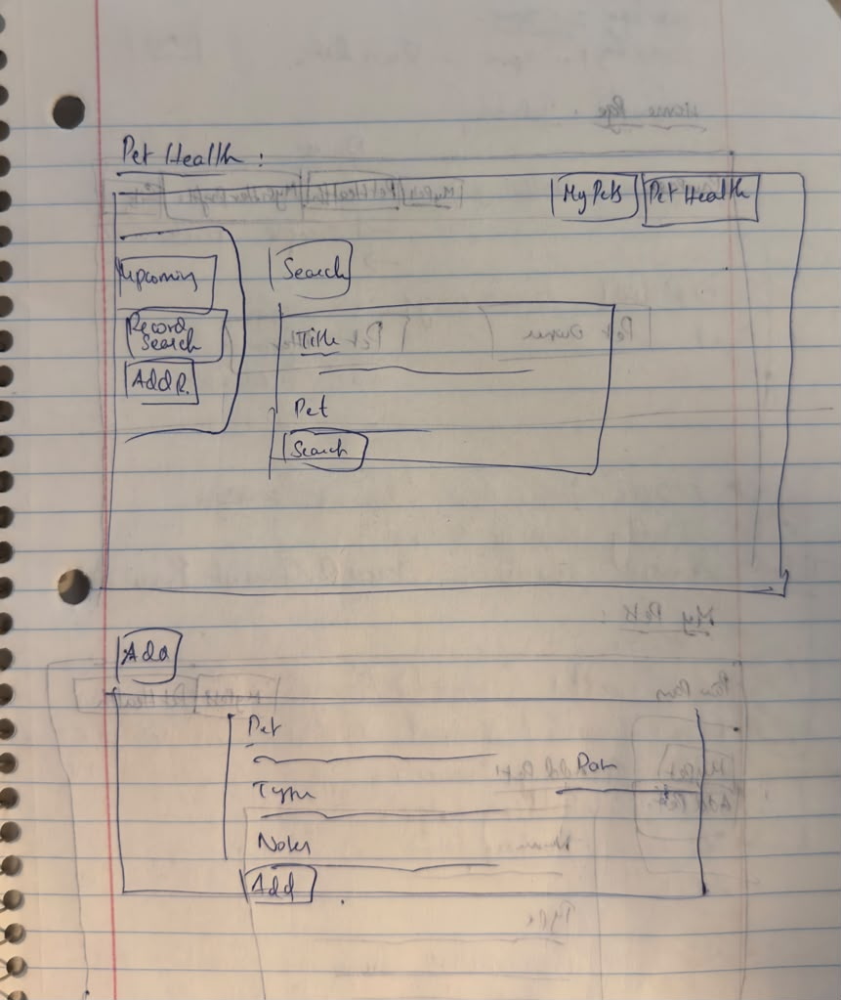
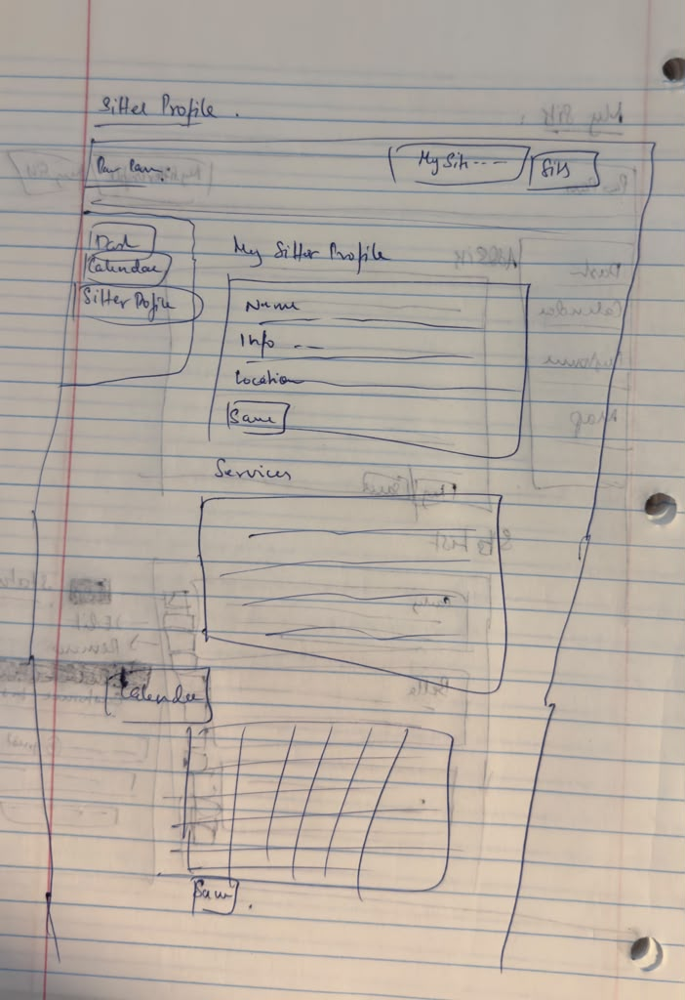
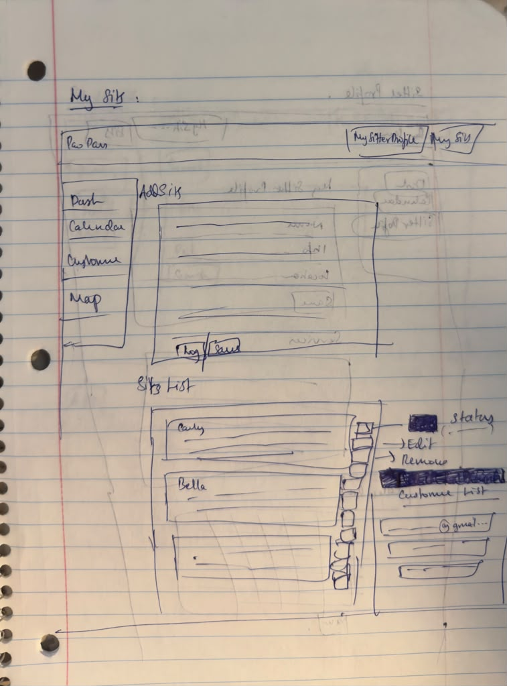

# Design Document - PawPass

- **Authors** Sai Venkatesh Varun Muruganandam Murali Krishnan, Sree Rachnae Shyam
- **Class** [CS5610 Web Development, Fall 2026](https://johnguerra.co/classes/webDevelopment_online_fall_2026/)
- **Website** https://pawpass-g001.onrender.com/index.html

## Project Description

PawPass is a pet care app. It helps a pet owner keep track of their pet's health and hand the important care information to a sitter. When someone new takes over a pet, owners usually have to explain everything again because the information is spread across vet papers, texts and notes. PawPass keeps it in one place.

The app has two sides:
- The **owner side** lets a pet owner add their pets, keep health records, and share a read-only Quick Facts link with whoever looks after the pet.
- The **sitter side** lets a pet sitter set up a profile with services and availability, and keep track of the sits they have booked. A sitter can attach an owner's Quick Facts link to a booking, so the information stays with the sit.

We built one side each. Varun built the owner side and Rachna built the sitter side.

The app has a home page and four feature pages:
- **Home** (index.html) explains what PawPass is and sends owners and sitters to their pages.
- **My Pets** (my-pets.html) is where an owner adds, edits and deletes pets, and creates the Quick Facts link.
- **Pet Health** (pet-health.html) shows upcoming appointments and the health records of the owner's pets.
- **My Sitter Profile** (my-sitter-profile.html) is where a sitter sets up their profile, services and availability.
- **My Sits** (my-sits.html) is where a sitter logs and tracks their sits.

## User Personas

### Persona 1: Priya, Pet Owner
Priya is a pet owner. She wants her pets' health history in one place, and an easy way to hand over care information to the person looking after her pets.

### Persona 2: Sam, Pet Sitter
Sam is a part-time pet sitter. He wants to list his services and keep track of the sits he has agreed to.

## User Stories

### User Story 1: Priya, Pet Profiles
As Priya, I want to create, edit, and delete pet profiles, so I can keep their info in one place.

Requirements for Acceptance:
- A pet has a name, species, breed, feeding, allergies, medications, vet name, vet phone and notes
- Name and species are required
- Pets can be edited or deleted from the My Pets page
- Deleting a pet asks for confirmation and also removes that pet's health records

### User Story 2: Priya, Health Records
As Priya, I want to create, edit, delete, and search health records, so I can track my pet's history.

Requirements for Acceptance:
- A record has a pet, a type (vet visit, vaccine, medication, appointment or weight), a date, a title and notes
- Records can be searched by title or notes, and filtered by pet and type
- The list shows 10 records at a time with Previous and Next buttons
- Records can be edited or deleted

### User Story 3: Priya, Upcoming Appointments
As Priya, I want to see upcoming appointments with urgency labels, so I can tell what needs attention first.

Requirements for Acceptance:
- The Upcoming panel lists appointments that are not marked done, soonest first
- Each appointment has a label such as Overdue, Today or In 3 days, with a matching color
- An appointment can be marked done

### User Story 4: Priya, Quick Facts Link
As Priya, I want to generate a read-only Quick Facts link, so I can hand care info to someone else.

Requirements for Acceptance:
- Each pet on the My Pets page has a button to create the link
- Anyone with the link sees a read-only card with the pet's feeding, allergies, medications, vet and notes
- The link can be turned off by the owner

### User Story 5: Sam, Sitter Profile
As Sam, I want to create, edit, and delete my sitter profile with my services and area, so I can show owners what I offer.

Requirements for Acceptance:
- The profile has a name, bio, location and pincode
- A service has a species, a rate per day, where the sit happens and what owners should prepare
- Services can be added, edited and removed

### User Story 6: Sam, Availability
As Sam, I want to mark my available days, so I can keep my schedule current.

Requirements for Acceptance:
- A month calendar lets Sam click a day to mark it available
- Each available day can be all day or a custom start and end time
- A day can be removed, and the changes are saved with the Save Availability button

### User Story 7: Sam, Bookings
As Sam, I want to create, edit, and cancel bookings with an optional Quick Facts link, so I can manage my sits.

Requirements for Acceptance:
- A booking has a pet name, the owner's contact, start and end dates, notes and an optional Quick Facts link
- Bookings can be edited or cancelled

### User Story 8: Sam, Sits and Status
As Sam, I want to view upcoming and past sits and update their status, so I can track each one.

Requirements for Acceptance:
- The My Sits page shows upcoming and past sits
- The status of a sit can be changed to requested, confirmed, completed or cancelled

## Design Mockups

These are screenshots of the finished pages.

### Home page

This is the home page. It has the navigation links, a short introduction, one section for pet owners and one for sitters, and three steps that explain how PawPass works.

### My Pets page

This is the My Pets page. It has a sidebar with two options, My Pets and Add a Pet. My Pets lists each pet with Edit, Delete and Create link buttons, and Add a Pet shows the form. A Quick Facts link opens a read-only card for one pet.

### Pet Health page

This is the Pet Health page. It has a sidebar with Upcoming, Records and Add a Record. Upcoming lists the next appointments with their urgency labels, Records has the search, the filters and the list, and Add a Record shows the form.

### My Sitter Profile page

This is the My Sitter Profile page. It has a sidebar with Dashboard, Calendar and My Sitter Profile. The Dashboard summarizes the profile, services and availability, the Calendar is a month view for marking available days, and My Sitter Profile has the profile form and the service form.

### My Sits page

This is the My Sits page. It has a sidebar with Dashboard, Calendar, Customers and Map. The Dashboard shows the next sit, the Calendar is where sits are logged and managed, Customers lists the owners the sitter has worked with, and Map shows the sitter's service area.
