# PawPass

Pet care, handed off right. PawPass helps pet owners track their pets' health
and hand off care details to a sitter, and helps sitters manage their
profile, availability, and the sits they've booked.

## Author

- Sree Rachnae Shyam
- Sai Venkatesh Varun Muruganandam Murali Krishnan

## Class Link

[CS5610 Web Development — add the course link here]

## Project Objective

When someone takes over temporary care of a pet — a sitter, a neighbor, a
family member — the information they need is usually scattered across texts,
sticky notes, and memory. PawPass solves this handoff problem with two
independent sides built by each team member:

- **Pet owners** (Sai) create pet profiles, log health records, track
  upcoming appointments, and generate a read-only **Quick Facts** link to
  hand off to whoever is watching their pet.
- **Sitters** (Rachna) manage their own profile and the services they offer,
  set their availability on a calendar, and track every sit from requested
  through completed.

The two sides never read each other's MongoDB collections. The only
connection between them is a plain-text Quick Facts link that an owner
shares and a sitter pastes into a booking — the same kind of link anyone
could text or email.

## Screenshots

**Homepage**
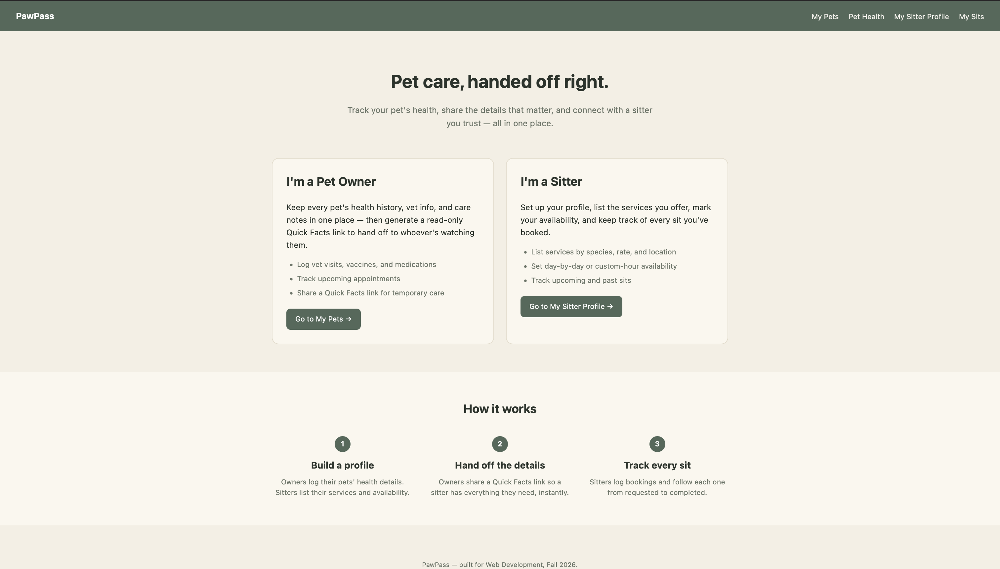

**My Pets**
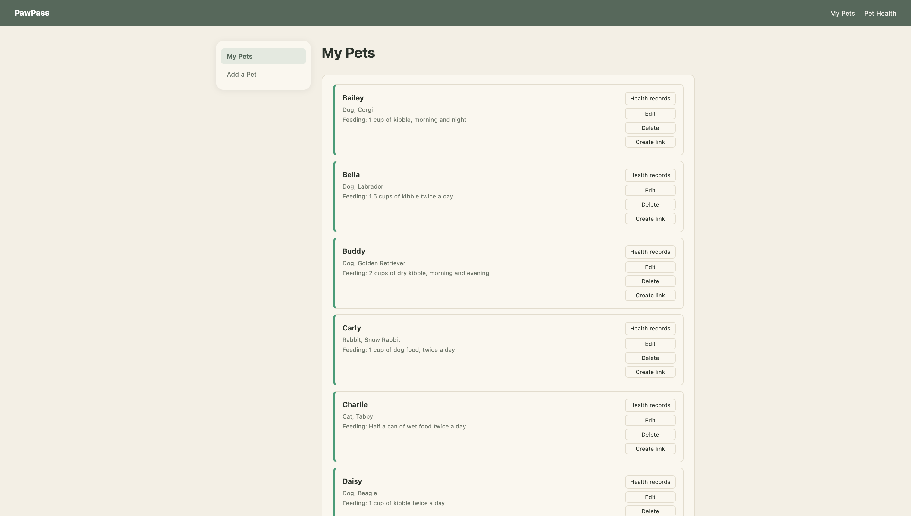
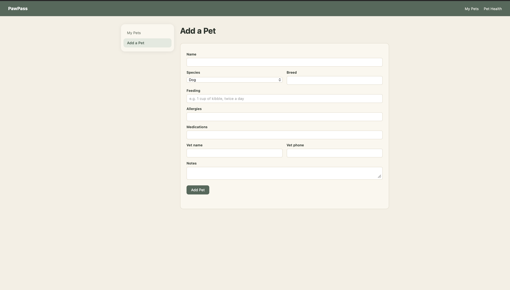

**Pet Health**
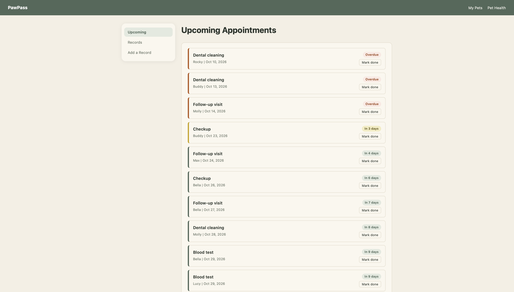
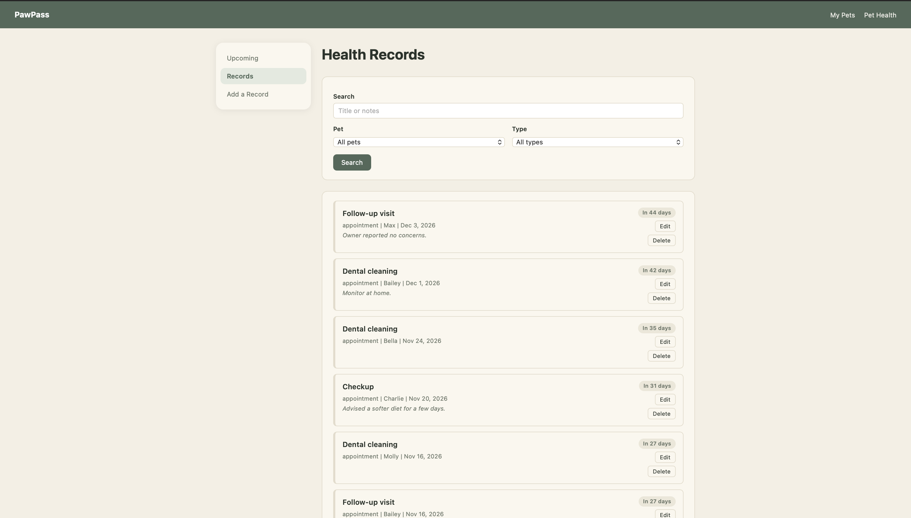
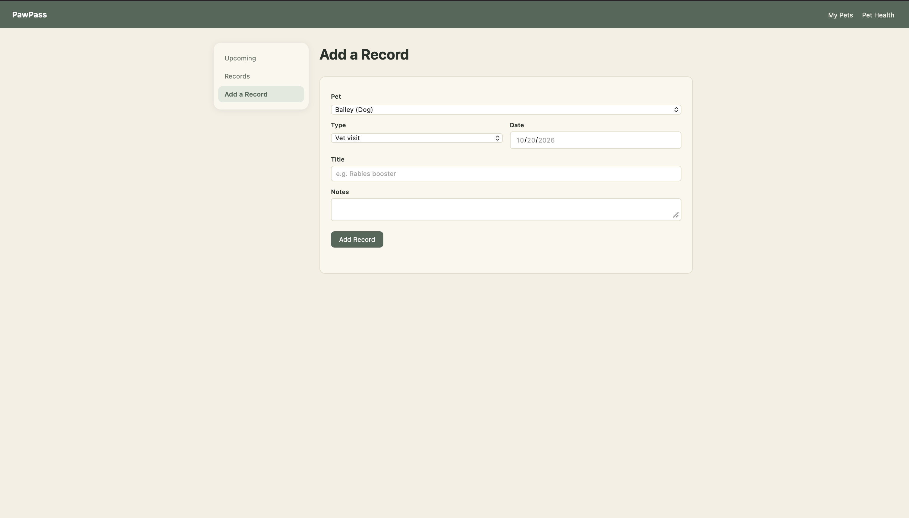

**My Sitter Profile**
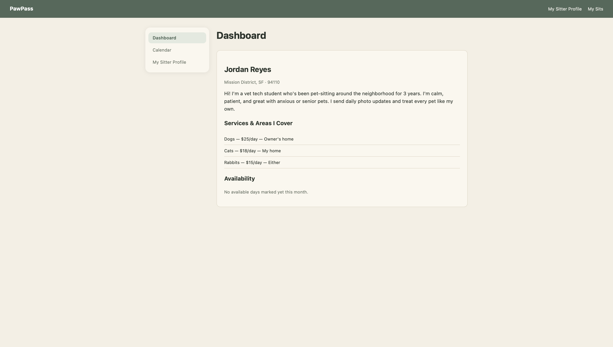
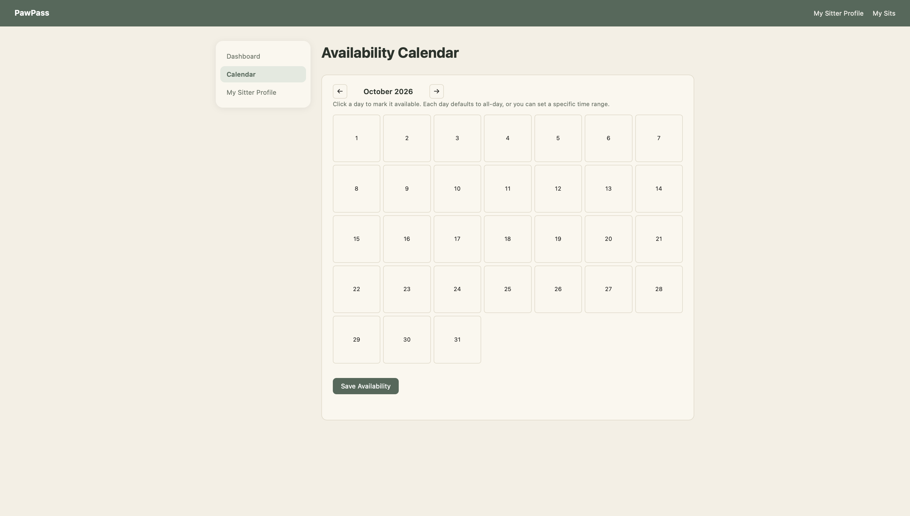
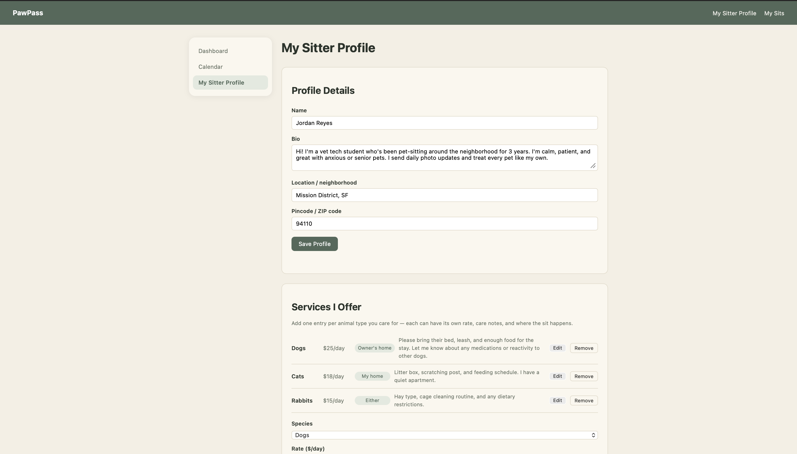

**My Sits**
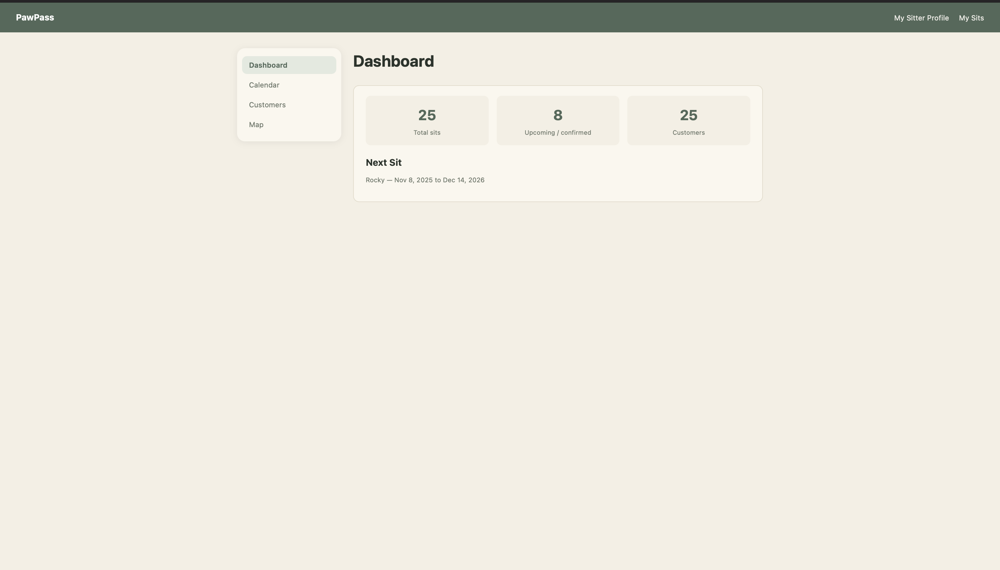
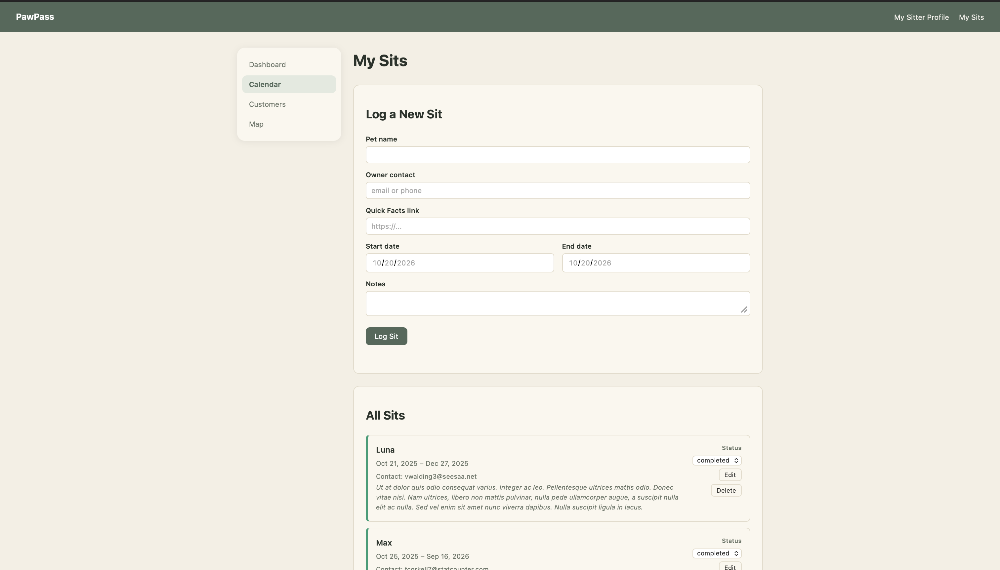
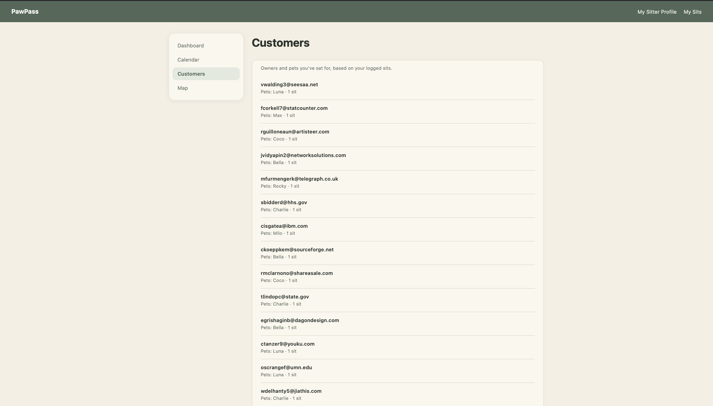
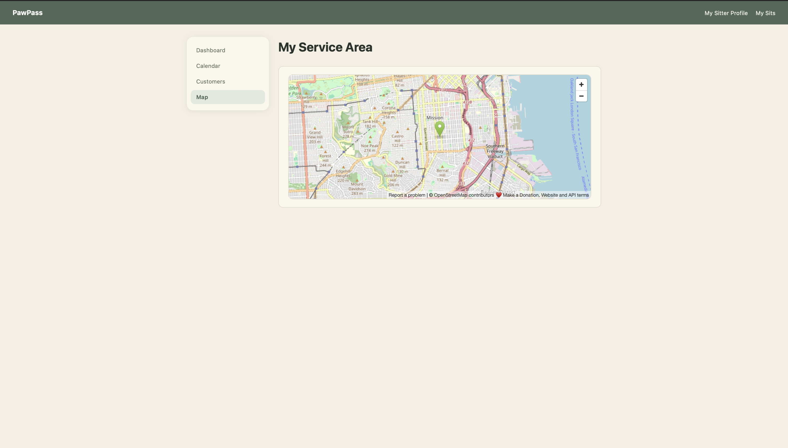

## Live Demo

Render deployment URL - https://pawpass-g001.onrender.com/index.html

---

## Tech Stack

- **Backend:** Node.js + Express
- **Database:** MongoDB, accessed with the native Node.js driver (no
  Mongoose)
- **Frontend:** Vanilla HTML5, CSS3, and ES6 JavaScript modules — no
  frameworks, no server-side rendering
- **Deployment:** Render
- **Linting/Formatting:** ESLint + Prettier

---

## Features

### Pet Owner side (Sai)

- Create, edit, and delete pet profiles (name, species, breed, photo, bio,
  feeding notes, allergies, medications, vet contact)
- Create, edit, delete, and search health records (vaccine, vet visit,
  weight, medication) per pet
- View upcoming appointments
- Generate and revoke a read-only **Quick Facts** share link per pet, viewable
  by anyone with the link — no login required

### Sitter side (Rachna)

- Create and edit a sitter profile: name, bio, location, and pincode
  (automatically geocoded server-side into map coordinates — no need to type
  raw latitude/longitude)
- Add, edit, and remove services offered, each with its own species, daily
  rate, care notes, and whether the sit happens at the owner's home, the
  sitter's home, or either
- Set availability on an interactive calendar with month/year navigation —
  each day defaults to all-day availability, or can be set to a custom time
  range
- Log, edit, and delete booked sits, attaching an owner's Quick Facts link as
  plain text
- Track each sit's status (requested → confirmed → completed, or cancelled)
- View a dashboard summarizing total sits, upcoming/confirmed count, unique
  customers, and the next scheduled sit
- View a read-only Customers list, grouped from booking history
- View their own service area on an embedded map

---

## Folder Structure

```
/
├── server.js
├── package.json
├── eslint.config.js
├── .prettierrc.json
├── README.md
├── LICENSE
│
├── db/                       — one file per collection, plus the shared connection
│   ├── connection.js
│   ├── pets.js
│   ├── healthRecords.js
│   ├── sitterProfiles.js
│   └── bookings.js
│
├── validation/               — one file per collection
│   ├── pet.js
│   ├── healthRecord.js
│   ├── sitterProfile.js
│   └── booking.js
│
├── routes/                   — one Express router per collection
│   ├── pets.js
│   ├── healthRecords.js
│   ├── sitterProfiles.js
│   └── bookings.js
│
├── utils/
│   └── geocodePincode.js     — converts a pincode to lat/lon via OpenStreetMap's Nominatim
│
├── scripts/                  — one-time seed scripts (see below)
│   ├── seedPets.js
│   ├── datarecords.json
│   ├── seedMockBookings.js
│   ├── mockBookings.json
│   └── seedPetResources.js
│
└── public/
    ├── index.html
    ├── pages/                — one HTML file per page
    │   ├── my-pets.html
    │   ├── pet-health.html
    │   ├── my-sitter-profile.html
    │   └── my-sits.html
    ├── css/                  — one stylesheet per page/module
    │   ├── home.css
    │   ├── pets.css
    │   ├── pet-health.css
    │   ├── sitter-profile.css
    │   ├── sidebar.css
    │   └── sits.css
    └── js/
        ├── config.js         — shared fixed demo identities (no auth in this project)
        ├── pets/
        ├── health/
        ├── sitterProfile/
        └── bookings/
```

---

## Setup / Instructions to Build

1. Clone the repo:
   ```
   git clone https://github.com/shyamrachna25/pawpass.git
   cd pawpass
   ```
2. Install dependencies:
   ```
   npm install
   ```
3. Create a `.env` file in the project root with your own MongoDB connection
   string:
   ```
   MONGODB_URI=mongodb+srv://<user>:<password>@<cluster>/pawpass?retryWrites=true&w=majority
   ```
4. Run the server locally:
   ```
   node --env-file=.env server.js
   ```
5. Open `http://localhost:3000` in a browser.

To lint and format the code:

```
npm run lint
npm run format
```

> Note: the `npm start` script (`node server.js`) does **not** include the
> `--env-file` flag, since the deployed version on Render injects
> `MONGODB_URI` directly as an environment variable rather than using a
> `.env` file. When running locally, use `node --env-file=.env server.js`
> directly instead of `npm start`.

---

## Seed Scripts

Three one-time scripts populate the database with realistic or real data.
Each is safe to re-run — they clear their own previously-seeded data first.

### `scripts/seedPets.js`

Seeds **10 pets and 1,200 health records** for the demo pet owner, generated
with [Mockaroo](https://www.mockaroo.com/) and stored in
`scripts/datarecords.json`. Run with:

```
node --env-file=.env scripts/seedPets.js
```

### `scripts/seedMockBookings.js`

Seeds **25 realistic sitter bookings**, also generated with Mockaroo
(`scripts/mockBookings.json`). Dates are corrected (Mockaroo generates start
and end dates independently, so this script fixes any row where they ended
up reversed) and each booking's status is computed from its dates relative
to today, rather than randomly assigned — a sit that already ended is marked
`completed` (or occasionally `cancelled`), a sit starting soon is
`confirmed`, and anything further out is `requested`. Run with:

```
node --env-file=.env scripts/seedMockBookings.js
```

### `scripts/seedPetResources.js`

Seeds **1,871 real veterinary clinics, pet stores, and dog parks** across
California, pulled live from [OpenStreetMap's Overpass
API](https://overpass-api.de/) (free, no API key). This is genuine
open-source reference data rather than fabricated placeholder records, and
on its own exceeds the 1,000+ record threshold with real-world data. It is
currently seeded but not surfaced in the UI. Run with:

```
node --env-file=.env scripts/seedPetResources.js
```

> This query is scoped to California via OpenStreetMap's own administrative
> boundary code (`ISO3166-2=US-CA`). To seed a different region, change that
> code in the script.

---

## API Endpoints

| Method | Endpoint | Description |
|---|---|---|
| GET | `/api/pets` | List all pets |
| GET | `/api/pets/:id` | Get one pet |
| POST | `/api/pets` | Create a pet |
| PUT | `/api/pets/:id` | Update a pet |
| DELETE | `/api/pets/:id` | Delete a pet |
| POST | `/api/pets/:id/share` | Generate a Quick Facts share token |
| DELETE | `/api/pets/:id/share` | Revoke a Quick Facts share token |
| GET | `/api/pets/shared/:token` | Public, read-only Quick Facts view |
| GET | `/api/health-records` | List health records (optionally filtered) |
| POST | `/api/health-records` | Create a health record |
| PUT | `/api/health-records/:id` | Update a health record |
| DELETE | `/api/health-records/:id` | Delete a health record |
| GET | `/api/sitter-profiles?sitterId=` | Get the current sitter's profile |
| POST | `/api/sitter-profiles` | Create a sitter profile |
| PUT | `/api/sitter-profiles/:id` | Update a sitter profile |
| DELETE | `/api/sitter-profiles/:id` | Delete a sitter profile |
| POST | `/api/sitter-profiles/:id/services` | Add a service |
| PUT | `/api/sitter-profiles/:id/services/:species` | Edit a service |
| DELETE | `/api/sitter-profiles/:id/services/:species` | Remove a service |
| PUT | `/api/sitter-profiles/:id/availability` | Replace availability |
| GET | `/api/bookings?sitterId=` | List bookings |
| POST | `/api/bookings` | Create a booking |
| PUT | `/api/bookings/:id` | Update a booking |
| PATCH | `/api/bookings/:id/status` | Update just a booking's status |
| DELETE | `/api/bookings/:id` | Delete a booking |
| GET | `/api/health` | Health check (confirms server + DB connection) |

No authentication is used in this project per course guidance — every page
agrees on a fixed demo identity (`public/js/config.js`) instead of a login
system.

---

## Use of GenAI Tools

We used Claude (Anthropic) for coding assistance, debugging, planning, and
design guidance throughout this project. [Add any further specifics required
by your course's disclosure policy — e.g., which parts were written
independently vs. with assistance.]

---

## License

MIT — see [LICENSE](./LICENSE)
